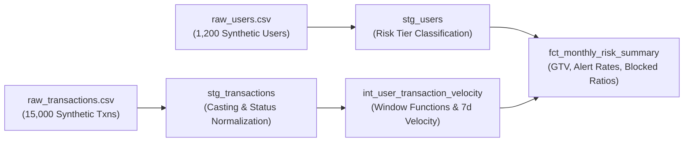

# FinTech Risk & Transaction-Monitoring Analytics Engineering (dbt Core)

[](https://getdbt.com)
[]()
[-green.svg)]()

### Author: Anouar Bouchaara
*Data & Analytics Specialist | Tallinn, Estonia*

---

## 📌 Executive Summary & Architecture

This repository demonstrates production-grade **Analytics Engineering patterns** for a high-volume, multi-currency FinTech scale-up. It transforms raw transactional and customer telemetry into clean, auditable dimensional models and compliance monitoring marts.

### Core Problems Solved:
1. **Multi-Currency Normalization:** Accurately converts multi-currency streams (`EUR`, `GBP`, `USD`, `CAD`, `AUD`, `SGD`) into standardized base EUR reporting figures without rounding leakage.
2. **Burst Velocity & Structuring Detection (AML):** Uses advanced SQL window frames (`RANGE BETWEEN INTERVAL 7 DAYS PRECEDING`) to calculate rolling spend velocity and flag suspicious transaction structuring (smurfing) in code.
3. **Regulatory Governance & Audit-Ready Lineage:** Implements Kimball dimensional modeling (`staging` $\rightarrow$ `intermediate` $\rightarrow$ `marts`), strictly enforcing primary key uniqueness, referential integrity tests, and metric documentation.



---

## 🛠️ Project Structure

```
fincrime_dbt_project/
├── dbt_project.yml
├── generate_synthetic_data.py       # Standalone 10k+ transaction generator
├── seeds/
│   ├── raw_users.csv                # 1,200 synthetic user accounts
│   └── raw_transactions.csv         # 15,000 synthetic multi-currency txns
└── models/
    ├── schema.yml                   # Generic & relationship test assertions
    ├── staging/
    │   ├── stg_transactions.sql    # Clean casts, snake_case aliases, flag logic
    │   └── stg_users.sql           # Geographic & KYC verification attributes
    ├── intermediate/
    │   └── int_user_transaction_velocity.sql # Window functions, LAG, rolling spend
    └── marts/
        └── fct_monthly_risk_summary.sql      # Board-ready compliance GTV & alert metrics
```

---

## 🔍 Key Engineering Highlights

### 1. Advanced Window Framing for AML Velocity
Rather than relying on brittle, slow application-side loops, windowed velocity is calculated directly inside the data warehouse:
```sql
-- Rolling 7-day volume per user
sum(amount_eur) over (
    partition by user_id
    order by transaction_created_at asc
    range between interval 7 days preceding and current row
) as rolling_7d_volume_eur
```

### 2. Automated Anti-Smurfing / Structuring Rule Detection
Flagging rapid consecutive transactions just under regulatory thresholds (€4,000–€9,999) executed within 60 minutes:
```sql
case
    when date_diff('second', previous_transaction_created_at, transaction_created_at) <= 3600
         and amount_eur between 4000.00 and 9999.00
    then true
    else false
end as is_suspected_smurfing_structuring
```

---

## 🚀 How to Run Locally

### 1. Requirements
- Python 3.10+
- `dbt-core` and adapter (`dbt-duckdb`, `dbt-postgres`, or `dbt-snowflake`)

### 2. Execution
```bash
# 1. Regenerate fresh synthetic data (if desired)
python3 generate_synthetic_data.py

# 2. Seed data into local warehouse
dbt seed

# 3. Run models and execute generic test assertions
dbt run
dbt test
```

---

## 🛡️ Data Privacy Notice
*All customer profiles, account IDs, and transaction amounts contained in this repository are 100% synthetically generated via Python pseudorandom generators. This repository contains zero proprietary data, models, or intellectual property from current or previous employers.*
